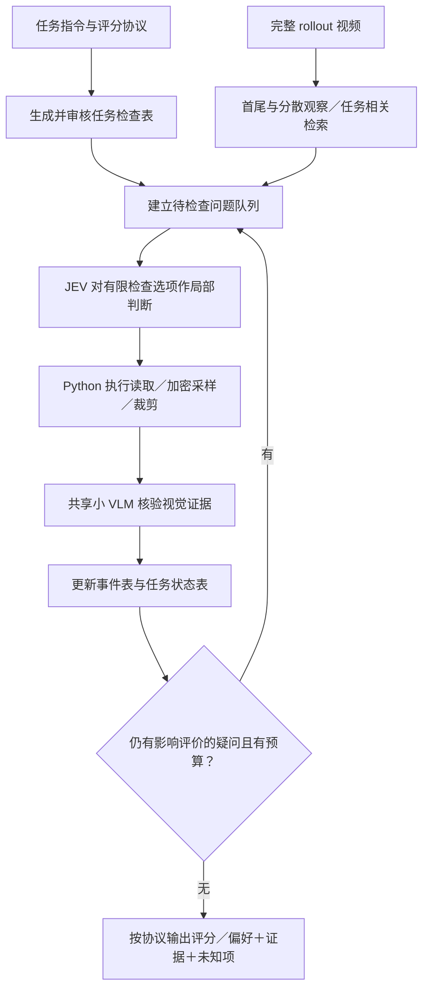

# FYP 框架维护文档：基于 JEV 的证据驱动机器人轨迹评价

## 当前执行规格 · 第一轮 · 2026-11-19

本轮交付单条 RoboRewardBench 视频的离线评价。Qwen 粗看一次，JEV 选窗，CPU 程序取证，先保存带时间的证据，再由 JEV 按 RoboReward 的终局 1–5 档评分或返回证据不足。第 1–12 节保留 10 月的研究方案，涉及选型、预算、循环补看和对比实验时以本节为准。

| 步骤 | 本轮行为 |
|---|---|
| 输入 | 从官方数据取得原始视频、任务指令、split 和样本 ID。评估入口只接收这些信息，参考分在预测保存后关联。 |
| 粗观察 | 从第一帧的时间戳开始，每 2 秒取一帧，并保留视频最后一帧，按原始帧号去重。通过百炼调用一次 `qwen3.6-flash`，取得与原帧编号对应的观察、候选对象框、任务要求和可测条件。对象身份与框均为模型提议，记录其来源。 |
| 选窗 | 相邻抽样帧定义候选窗口。`jev-1.14.0` 逐窗选择 0（无关）、1（相关但重复）、2（存在可核验的要求）、3（核心歧义、矛盾或撤销）。所有窗口（包括结尾）按同一阈值筛选：2、3 档进入核验，0、1 档跳过。JEV 为每项要求选择布局、相对运动、两者或均不适用。可在同一次 JEV 请求中提交这些问题。 |
| 专家测量 | Python 在原始帧范围运行 OpenCV。以粗看给出的窗口起点框为种子，尝试匹配目标与参照物，记录逐帧像素框。布局程序测量图像平面内的框间距，相对运动程序测量两者相对中心的最大位移。相同窗口和对象对共享匹配结果。 |
| 证据 | 记录时间戳、原始帧号、任务要求、框与绑定来源、测量值与单位、适用条件的判断和未知原因。运动阈值和匹配阈值是原型设置，需验证。模板不适用于大形变、严重遮挡、镜头或视角明显变化的物理解释。二维框重叠不足以验证三维放置、接触或释放。 |
| 终分 | JEV 只读任务、要求和已写盘的程序证据。时间窗优先级和粗观察叙述不参与终分。它根据终局 rubric 选择 1–5 档或弃答；全部已选窗口都缺乏有效证据、或 5 档缺乏每项要求的最新支持证据时，控制器保留原始选择并输出弃答。JEV 根据已核验证据判断其能否支持终局分，允许末段未入选。 |

评价入口和 CPU 工具均在 `evaluate_rollout.py`。运行环境需要 Python 3.11+、OpenCV、NumPy、ffprobe，两种服务的密钥分别由环境变量 `DASHSCOPE_API_KEY` 和 `TYPESAFE_API_KEY` 提供。百炼默认使用国际站兼容端点，可通过 `DASHSCOPE_BASE_URL` 选择与账号地域一致的地址。以下命令的输入替换为同一条 RoboReward 样本的真实字段，输出目录须为新目录。

```sh
python evaluate_rollout.py --video "$ROLLOUT_VIDEO" --task "$ROLLOUT_TASK" \
  --episode "$ROLLOUT_SAMPLE_ID" --split test --out run-001
```

每次运行保留 `run.json`（视频哈希、抽帧与时间映射、版本和参数）、实际输入 JPEG、逐调用请求与响应（含服务返回的用量和本地计时）、`03-evidence.json`、`result.json`。单条证据的帧号可通过视频哈希和时间映射回放。数值结果适用于申明的二维条件；没有对应工具的条件按未知处理。首轮证据可以用于第二轮定位和再标注。Qwen 的粗观察看过首尾，因此生成严格前缀监督时仍需排除未来信息。RoboRewardBench 的 test 样本保留作评测。

### 粗观察的时间间隔与输入成本

RoboRewardBench 的官方 test 清单有 2,831 条。逐文件读取 MP4 视频轨的时间表（`stts` 和媒体时间尺度）得到每条编码视频的帧数和播放时长，全部为 10 fps。随机分层调查后完成了全量读取，另以 ffprobe 复核 4 个来源各 1 条。测试视频时长最短 0.3 秒，中位数 15.3 秒，90 分位 40.1 秒，最长 119.0 秒。[固定版本的官方清单](https://huggingface.co/datasets/teetone/RoboReward/blob/d69d5b92b8f3caee9a616b615b300bdf0d37aef2/test/metadata.jsonl) · [逐视频时长、输入帧数及最大间隔](notes/roborewardbench_video_durations.csv)

旧版按帧号均匀取最多 8 帧，有 1,468 条（51.9%）出现超过 2 秒的采样间隔。时长 40.1 秒的视频共有 603 条，各自的最大间隔为 5.8 秒。新版以原始显示时间戳每 2 秒采一次，取每个非空时间段的第一帧，另包含末帧。40.1 秒的视频因此取 21 帧，最长的 119.0 秒视频取 61 帧。全体样本平均从 7.94 帧变为 11.97 帧，仍在一次 Qwen 请求内提交；实际 token 与费用以服务返回值为准。时长统计说明采样覆盖，评分误差与短事件召回仍需另行测量。可用 `--sample-interval-seconds` 调整间隔，`run.json` 保存设定值、实际帧数和最大间隔。末帧出现在粗观察输入中，末段仍须通过 JEV 的同一核验阈值。

### 粗观察里“候选框”的含义

例如“把米色积木放到托盘左侧的柱子上”，Qwen 可以在一张原图上分别给“米色积木”和“左侧柱子”各一个矩形框。每个框保存左上角和右下角坐标 `[x1,y1,x2,y2]`，横纵轴分别归一化到 0–1000。JEV 选中一个窗口后，OpenCV 用**窗口起始帧**中的两个框裁取图像模板，再在窗口内跟踪和测量。对象被遮挡或身份不清时可以省略框；框缺失或匹配失败会留下未知原因。两个框靠近或重叠只能提供二维位置线索，无法据此证明积木已插到柱子上。

VeriPhy 区分测量、学习型子判断和三值结论。其对象细类、动作事件和深度次序仍有学习型核验；本项目采用其带类型和来源的证据设计，并自行选择 JEV 终局评分。[VeriPhy §4.3](https://arxiv.org/html/2609.03153v1#S4.SS3)、[RoboReward 附录 A.2.2](https://arxiv.org/html/2601.00675v2)、[JEV 接口](https://docs.typesafe.ai/models)

## 历史方案 · v0.1 · 2026-10-24

## 1. 项目定义

本项目构建一个**离线、预算受限、证据驱动的机器人 rollout 评价框架**。输入任务指令和完整 rollout 视频，系统先定义需要满足的任务要求，再通过基础观察和轻量检索定位候选片段；JEV 根据当前证据和未解决问题选择下一项检查，共享小型 VLM 配合视频读取、加密采样和裁剪取得证据。系统持续更新历史事件与当前任务状态，在证据足够或预算耗尽后，输出任务完成分，或同任务两条 rollout 的相对偏好，并附证据和未知项。

**首版配置：JEV＋一个冻结的小型 VLM＋一个冻结的图文检索编码器＋Python 控制器。** 检查表生成、粗观察和视觉核验复用同一个 VLM；控制器执行工具、维护状态和管理预算。不同逻辑角色不需要独立大模型。

项目主要检验：在相同小型 VLM 和可比推理预算下，这种组织方式能否提高评分与人类标签的一致性，并减少把“尝试、错误对象或已撤销成果”误判为成功的情况。首版完成离线评价，不要求训练 reward model、运行机器人或证明下游 RL 收益。

## 2. 评价目标与范围

| 输出 | 评价什么 | 主要依据 |
|---|---|---|
| 任务完成分 | 一条轨迹完成了多少任务 | 对齐指定数据集 rubric 的已核验任务状态 |
| 相对偏好 | 同任务两条轨迹中哪条更好 | 完成情况、明确任务约束、成果保持及约定的过程参考 |
| 过程诊断 | 为什么成功、失败或无法判断 | 尝试、重试、撤销、恢复、遮挡等事件 |

主评价关注正确对象、实际子目标结果、明确要求的顺序或方式，以及成果是否保留。重试和停顿主要用于解释；成功重试不自动降低完成分。碰撞、杯子倾倒、速度和平滑度仅在任务或评价协议要求时进入主评价。

**必须区分终局完成度与历史最高进度。** RoboReward 使用终局五档评分；RoboArena 原生进度分表示过程中达到过的最高进度，其偏好还包含人类综合判断。首版只用 RoboArena 的原生偏好，不用它的进度分验证终局评分；若后续加入进度分实验，再单独实现最高进度适配器，不将两类标签线性换算后混用。[RoboReward 附录 A.2.2](https://arxiv.org/html/2601.00675v2)、[RoboArena §3.1](https://arxiv.org/html/2506.18123v2)

## 3. Related works 与本项目的关系

| 工作 | 本项目借鉴什么 | 使用边界 |
|---|---|---|
| [VeriPhy: Agentic Physical Reasoning for World Model Evaluation and Refinement](https://arxiv.org/abs/2609.03153) | 先定义要求，再按要求取证；记录证据来源和未知项 | 原工作评价生成视频的物理可靠性；本项目不复现其完整物理测量工具体系 |
| [ARS: Agentic Reward System for Robot Learning](https://arxiv.org/abs/2609.34484) | 主动查看局部视频、事件提议后核验、允许进度撤销 | 最直接的相关工作；这些机制已有先例，本项目重点是 JEV 受约束路由、共享小 VLM 和预算下的评价效果 |
| [HiMu: Hierarchical Multimodal Frame Selection for Long Video Question Answering](https://arxiv.org/abs/2603.18558) | 将任务分解后交给廉价模型寻找候选位置 | 首版只用图文检索，是简化借鉴，不是完整复现 HiMu |
| [A.I.R.: Enabling Adaptive, Iterative, and Reasoning-based Frame Selection For Video Question Answering](https://arxiv.org/abs/2510.04428) | 廉价候选检索、少量语义判断与迭代补看 | 原工作是 VideoQA 帧选择；相关性不能直接证明机器人操作成功 |
| [R²VLM: Recurrent Reasoning with Vision-Language Models for Estimating Long-Horizon Embodied Task Progress](https://arxiv.org/abs/2603.17312) | 局部短片段结合持续更新的任务完成记忆 | 原工作训练模型维护推理记忆；本项目用冻结模型和显式表格，不复现其训练 |
| [Robometer: Scaling General-Purpose Robotic Reward Models via Trajectory Comparisons](https://arxiv.org/abs/2603.02115) | 将轨迹内进度与轨迹间偏好放在统一评价背景中 | 是专用训练模型，可作扩展对照；本项目的评分与偏好由同一证据记录支持 |
| [RoboReward](https://arxiv.org/abs/2601.00675)、[RoboArena](https://arxiv.org/abs/2506.18123) | 完成分与偏好的现成评价数据及协议 | 使用原有标签语义，减少新建标注体系的工作 |

研究表述采用“工程上可实现的评价框架及其验证”。不预先声称比 ARS 更准确、更便宜，或首次提出 agentic reward evaluation。

## 4. 总体流程



Agentic 性来自闭环：**已有证据决定下一项检查，检查结果改变状态，新的缺口触发补查，预算和证据决定停止。** 首版让 Python 管理这个闭环，不让模型自由编写整套执行计划。

### 4.1 任务检查表：评分要求与取证问题分开

检查表只根据任务、评分协议和工具清单生成，同任务复用；人工按任务审核一次。程序检查字段、工具可用性和依赖无环，不能仅凭程序校验保证语义完整。

以“打开抽屉，把红色积木放进去，然后关闭抽屉”为例：

| 评分要求 | 取证问题 | 主要证据 |
|---|---|---|
| 指定对象进入抽屉 | 是否为红色积木？是否已经释放并留下？ | 对象身份、放置前后及释放后画面 |
| 轨迹结束时抽屉关闭 | 是否真正关闭？ | 末段状态 |
| 明确要求的执行顺序 | 是否存在有效的打开→放入→关闭事件链？ | 已核验事件的时间关系 |
| 成果保持 | 后续是否有取出或掉落等反证？ | 后续相关片段与终局证据 |

“打开”是这个任务的过程要求和放入前提，不要求它在终局仍保持。检查表分别标记 `terminal_state`、`historical_event` 和 `ordering_constraint`，避免把中间状态当成最终必须同时满足的状态。“释放后留下”用于证明放入，不再另算一个加分项。

每项保存要求、对象、要求类型、核心／辅助属性、依赖、成功证据与可能反证。只约束任务明确要求的先后关系，允许重试和其他有效路径。核心与辅助要求按原 rubric 解释；顺序是否影响主分由输出协议规定，不能把额外过程规则加入只按终局标注的测试集。

### 4.2 视频索引：覆盖整段，再找相关位置

控制器建立带原始时间戳的帧和片段索引，包含首尾、均匀过程观察，以及每个要求的多个检索候选。首版用 CLIP 图文相似度，缓存帧特征；查询同时描述动作和结果，如“placing a red block into a drawer”和“a red block inside an open drawer”。

每项保留时间上分散的多个候选，低相似度只表示没检索到，不能判失败。保留一部分预算查看未覆盖区间。静态图文编码器不负责证明释放、先后关系或操作成功。

### 4.3 JEV：选择值得检查的问题

首版采用**结构化观测→JEV 文本决策**：VLM 提供可见对象、状态、候选事件和不确定项；JEV 同时读取相关任务状态与待检查问题。它只回答小范围选择题，例如：

| 决策 | 选项示例 |
|---|---|
| 当前证据是否缺少决定性结果？ | 缺释放后画面／缺对象身份／已有证据／无法判断 |
| 这个未知项是否可能改变结论？ | 可能／基本不会／无法判断 |
| 对一个待检查问题，下一项适合什么检查？ | 查看后续／扩大窗口／裁剪／查看未覆盖区间／暂无有效检查 |

控制器先执行必需的首尾和基础覆盖，再根据问题重要性、矛盾、未知项和检查成本排序；JEV 为局部路由提供判断。工具选项、候选窗口、去重、依赖与预算均由程序约束。JEV 不决定一个新工具的实现方式，也不生成检查表或长段解释。

JEV 官方接口提供 Choice、Score、Noul，强调原子问题；图像输入目前属于实验功能。因此直接将小组图片传入 JEV 只作为后续配置对照，首版不依赖它。[官方接口说明](https://docs.typesafe.ai/introduction)、[图像文档](https://docs.typesafe.ai/images)

### 4.4 视觉核验：重新查看实际结果

核验器收到具体问题、局部视频证据和必要的对象信息，在新上下文中查看动作前、中、后画面，输出 `supported / contradicted / unknown`、事件时间范围、简短观测和证据引用。问题应为“释放后红色积木是否留在抽屉内”，避免带有“已成功放入”的诱导结论。

工具首版只需 `read_window`、`resample_window`、`crop_region` 和前后帧比较。优先扩展时间窗口；目标太小时才裁剪，并保留原图以免丢失空间参照。检测、分割、跟踪仅在定位错误成为主要瓶颈后添加。

新上下文和新画面有助于修正初步判断，但共享 VLM 的两次判断仍可能产生共同错误，不能称为独立验证。

### 4.5 长程记录：历史事件与当前状态分别维护

| 记录 | 最小字段 |
|---|---|
| 事件表 | `event_id, requirement_id, object_id, time_range, event_type, verdict, evidence_ids, revision` |
| 任务状态表 | `requirement_id, ever_achieved, current_status, last_verified_time, supporting_events, invalidating_events, unknowns` |
| 证据表 | `evidence_id, video_id, timestamps, crop_coordinates, tool/model_version` |

事件类型包含尝试、达成、撤销和恢复；判断状态采用支持、反驳、未知。控制器按已核验事件的时间顺序重算相关任务状态，不简单累加成功次数。若事件被修改，依赖它的顺序和评分判断一并失效重算，旧版本保留用于追溯。

例如，20 秒放入成功、27 秒取出：历史表保留两个事件，`ever_achieved=true`，但当前“积木在抽屉内”不满足。若后来重新放入，则恢复当前状态。

若扩展到最高进度评价，要按时间重建**联合任务状态**，逐时应用对应 rubric，再取已观察到的最大值；不能把各要求在不同时刻的 `ever_achieved` 合并成一次完整成功。

**未观察到撤销不等于证明从未撤销。** 被遮挡的物体可以依据连续性暂时沿用上次状态，但要注明是状态延续推断；若关键间隔未覆盖、发生可疑交互或存在矛盾，就补查或保留未知。普通稀疏采样不提供对整段视频的完整事件保证。

### 4.6 补查与停止

优先补查正确对象不清、只有动作没有结果、前后矛盾、疑似撤销，以及会影响两条轨迹比较的未知项。每次补查必须关联一个问题和预期可获得的证据。

满足任一条件即停止：主要评分问题已获得充分证据；调用／视觉预算耗尽；连续两次补查没有新增有效证据。最后一种情况指实际证据或状态未改变，而不只是模型重复相同答案。停止理由与未解决问题写入输出。

JEV `confidence` 是回答概率分布的统计量，不是本任务准确率，更不是视觉证据充分性的保证。任何路由阈值都在开发集确定；关键要求仍未知时不能仅因 confidence 高而宣布完成。[官方 confidence 文档](https://docs.typesafe.ai/confidence)

## 5. 输出规则

### 5.1 单条 rollout 完成分

首版对齐 RoboReward 五档终局 rubric：

| 分数 | 判定摘要 |
|---|---|
| 1 | 终局没有与目标相关的有效变化 |
| 2 | 有少量进展，但远不足以完成 |
| 3 | 有明显进展，但仍违反核心要求或多个要求 |
| 4 | 核心对象与关系已满足，仅缺一项辅助要求 |
| 5 | 终局满足全部要求 |

上述为维护用摘要，实际 prompt 使用原论文完整定义。评分根据已核验状态匹配等级，不使用“完成子目标数／总数”。抽屉关闭、正确对象放入、保持成功等要求不天然等权。过程事件为解释终局提供证据，不将重试次数额外转换成扣分。[原始 rubric，附录 A.2.2](https://arxiv.org/html/2601.00675v2)

首版优先用 JEV Choice 输出 `level_1…level_5`，由 Python 检查明显的证据冲突，例如核心对象已确定错误却给 5 分。出现冲突时最多一次复查；无法解决则标记未知，不能靠程序随意改成某个低分。若以后用 Score，注意官方等级从 0 编号且返回概率加权均值；五档需要映射到 1–5，离散评测转换规则须预先固定。[Score 文档](https://docs.typesafe.ai/primitives/score)

正常输出包含分数、协议、主要依据、证据时间戳、未知项、停止原因和成本。若关键未知项会跨越等级，返回“无法确定”或有依据的候选等级集合；其范围不是统计置信区间。

### 5.2 两条 rollout 相对偏好

分别生成两条轨迹的证据摘要，复用同一份任务检查表和相同单轨迹预算；随后以匿名 A/B 比较。默认先看完成情况、任务明确约束和成果保持，完成相近时再参考重试和无关操作等诊断。输出 `A / B / tie / insufficient_evidence`，并引用决定比较的事件。

同为 5 分仍可有过程偏好；分数相同也不必强行分出胜负。RoboArena 的原生人类偏好没有固定扣分公式，因此 agreement 衡量与其综合判断的符合程度，不等于所有不一致都证明框架的任务完成判断错误。原始标签若不含 tie，不凭空制造 tie 真值。

## 6. 候选模型与首版选择

| 组件 | 首版建议 | 候选／切换条件 |
|---|---|---|
| 共享视觉与文本模型 | 冻结 [Qwen3.5-4B](https://huggingface.co/Qwen/Qwen3.5-4B)，生成检查表、结构化观察和局部核验 | [Qwen3-VL-4B-Instruct](https://huggingface.co/Qwen/Qwen3-VL-4B-Instruct) 为同规模备选；资源更紧时试 [Qwen2.5-VL-3B-Instruct](https://huggingface.co/Qwen/Qwen2.5-VL-3B-Instruct) |
| 局部路由与等级判断 | JEV Choice；记录实际返回的固定模型版本 | 规则路由和同 VLM 文本 Choice 作为替代对照；图像 JEV 仅作扩展 |
| 候选检索 | 冻结 [CLIP ViT-B/32](https://huggingface.co/openai/clip-vit-base-patch32) | 若检索召回不足，再试 [SigLIP 2 Base](https://huggingface.co/google/siglip2-base-patch16-224)，不同时运行多个检索模型 |
| 专用 reward baseline | [RoboReward-4B](https://huggingface.co/teetone/RoboReward-4B) | 资源允许再加 [8B](https://huggingface.co/teetone/RoboReward-8B)；偏好扩展对照可选 [Robometer-4B](https://huggingface.co/robometer/Robometer-4B)；均不作为首版证据核验器 |
| 控制器与工具 | Python、视频解码、图像裁剪、JSON 校验、缓存 | 首版不引入完整检测／分割／跟踪模型群 |

选择依据是接口与部署可行性，不是宣称以上组合已在本任务最优。ARS 报告 Qwen3-VL-4B 在其自由 agent 流程中遇到工具和约束遵循失败，而 Qwen3.5-4B 能完成相应评估；这支持优先试后者，并让 Python 承担控制逻辑，但不能直接推断本框架准确率。[ARS 附录 F.1](https://arxiv.org/html/2609.34484v1)

先用约 20 条开发视频检查对象辨认、释放后状态判断、JSON 合法性、耗时和显存。若视觉核验能力不足，再考虑更大模型；不靠增加 agent 数量解决。显存随精度、分辨率和帧数变化，部署前实测，不承诺固定硬件门槛。

## 7. 数据集与样本方案

| 数据 | 首版用途 | 已有内容与限制 |
|---|---|---|
| [RoboReward 的 test split / RoboRewardBench](https://huggingface.co/datasets/teetone/RoboReward) | 五档完成分主实验 | 2,831 个 human-verified 视频—任务—评分样本；适合终局评分，不能单独证明长程能力 |
| [RoboArena 2026-07-17 快照](https://huggingface.co/datasets/RoboArena/DataDump_07-17-2026) | 原生同任务偏好；筛选多阶段案例 | 3,883 sessions、10,783 policy episodes；多视角视频不是独立 rollout；部分 session 超过两条轨迹 |
| RoboArena 多阶段人工审核子集 | 事件、撤销与状态更新的机制诊断 | 筛出至少三个可区分阶段或明确依赖的任务，再逐条确认视频；真实数量待筛选 |
| [CALVIN](https://github.com/mees/calvin)、[LIBERO-10 / Long](https://github.com/Lifelong-Robot-Learning/LIBERO) | 长程数据不足时的扩展 | 原生 play／示范数据不等于已标注失败的 policy rollout；通常还需运行 policy 或审核第三方失败轨迹 |

建议规模是项目设计，不是数据集规定：

- **开发：** RoboReward validation 100–200 例，RoboArena 30–50 个独立 session；用于 prompt、预算和阈值选择。
- **完成分测试：** 首轮按 source 和等级分层、尽量保持原比例抽 300–500 例；可用时扩到完整 2,831 例。若有意超采样少数等级，将其作为单独诊断，或用预定抽样权重估计总体误差。子集结果明确标注为 subset，不能直接与完整榜单比较。
- **偏好测试：** 100–200 个有效原生双轨迹 session；只选恰好两条 rollout、偏好可解析、视频完整的配对。
- **长程审核：** 30–50 条测试 rollout，只标主要事件、粗时间范围、终局状态及未知项；抽约 20% 请第二人独立复核。这个规模用于机制审核与 case study，不独立支撑总体长程性能结论。

优先主摄像头单视角，按固定规则选择；缺失则按预先规定回退。各方法使用相同视角。若改用多视角，单独记录并计入预算，避免按轨迹挑选对某方法最有利的视角。

RoboRewardBench 是对既有评分的人工核验筛选，不是多人独立盲标。RoboArena 的主观偏好也存在判定差异，结果应结合分歧案例解释。[RoboReward 附录 A.3](https://arxiv.org/html/2601.00675v2)、[RoboArena 附录 D](https://arxiv.org/html/2506.18123v2)

## 8. 怎样评价“框架给分好不好”

### 8.1 主指标

| 问题 | 主要指标 | 补充检查 |
|---|---|---|
| 完成分接近标签吗？ | MAE：平均绝对等级误差；同时报 sample-wise 与官方 group-wise MAE | Exact accuracy、混淆矩阵、严重误差率 `abs(pred-label) >= 2` |
| 能选出人类偏好的轨迹吗？ | 原生标签上的 pairwise agreement | A/B 对调后的判断一致性；按完成度接近／差距明显的子集分析 |
| 不确定时是否合理保留未知？ | Coverage 与 risk–coverage 曲线 | 已回答部分 MAE／错误率、弃答原因与比例 |
| 长程记录可信吗？ | 人工审核中的关键事件 precision/recall、终局要求状态 accuracy | 将尝试误报成功、漏掉撤销、缺证据却断言的比例 |
| 代价可接受吗？ | 每轨迹实际视觉输入量、模型调用数、耗时及 API 成本 | 推理失败率、预算耗尽率 |

RoboReward 论文以 MAE 为核心，榜单 overall 使用各数据子集 MAE 的平均；子集来源映射不可用时只报告能够正确计算的 sample-wise MAE，不把两者混称。[官方指标与结果说明，§5.1](https://arxiv.org/html/2601.00675v2)

机制审核预先固定事件匹配规则：相同要求、对象、事件类型，时间区间采用固定粗 tIoU 门槛（初始候选 0.3，开发集确定后冻结），一对一匹配，并审核引用证据确实支持事件；不能只凭区间相交命中。漏检事件计入 recall 分母，不能只审查模型报告过的事件。30–50 条不追求精确动作边界或逐帧 reward。

**unknown 不能提高表面成绩。** 主基准另设固定的 forced-prediction 模式，为每例输出最可能的等级／原生偏好类别，所有例子进入分母；这个额外文本判断也计入预算。正常模式允许弃答，另报 coverage 与选择性误差。接口失败和预算失败保留在清单中，并报告失败率；不能只保留成功运行的样本。正常模式的 tie 与证据不足也分别记录，不能合并。

为生成 risk–coverage 曲线，预先用最终 Choice 的最大选项概率排序，将存在关键未知或未解冲突的样本排在末尾，相同分数组合放行；开发集固定正常模式阈值，测试集扫描阈值只用于画曲线。该分数只是可靠性排序信号，不当作校准后的正确率。若最终连强制点预测也无法生成，按开发阶段固定的常数等级／偏好多数类作主表回退，同时单列失败和回退比例。

### 8.2 必要 baseline 与消融

| 对照 | 保留什么／改变什么 | 回答的问题 |
|---|---|---|
| Uniform one-shot | 同 VLM、同 rubric，均匀帧一次判断 | 复杂流程是否比直接看视频有效？ |
| 静态检查表＋检索 | 各要求按固定候选检查，保留同样状态表和评分器，不自适应补查 | 增益是否来自闭环选证据？ |
| 规则路由 | 保留完整流程，以未知／矛盾优先规则替代 JEV 路由 | JEV 路由本身是否有价值？ |
| 同 VLM 路由（扩展） | 用共享 VLM 的文本选择题替代 JEV 路由，其他组件固定 | JEV 与普通模型选择题相比的质量与成本如何？ |
| 无事件状态更新（先在长程子集） | 相同取证接口，改为简单观察摘要，不显式处理撤销和依赖重算 | 显式长程状态记录有何作用？ |
| RoboReward-4B | 按作者方式输出完成分 | 与任务专用 reward model 相比如何？ |

为隔离 JEV 的路由作用，“规则路由”与完整框架保留同一最终评分器。若还想检验 JEV 评分能力，可在**同一冻结证据摘要**上另比 JEV 与共享 VLM，不与路由改动同时混在一个消融中。

ARS 是应讨论的直接参考；完整复现依赖工具兼容与算力，放扩展实验。若自行实现简化版本，标为“ARS-inspired”，不把它的结果称为官方 ARS。RoboReward 不直接输出原生人类偏好；按分数差构造的比较只能作为 completion-based preference baseline。

Robometer 可作为偏好专用扩展对照；若将其连续进度转成五档，须使用可核实的官方评测接口，或只在开发集确定映射并标为自定义适配，不能任意线性取整后称官方复现。

同 VLM 对照设相同累计视觉 token 上限、分辨率和输出限制；重复输入和裁剪也计入。不同模型的 token 不直接等价，再同时报告总成本和耗时。专用模型按作者默认设置另表报告；不要把其默认采样结果误称严格同预算对照。

总成本包含检索编码、检查表生成和最终文本判断，分别报告首次运行成本及缓存复用后的摊销成本。首版优先跑完整框架、Uniform、静态检查和规则路由四种配置；记忆消融先跑长程审核子集，避免一开始扩成大量模型组合。

### 8.3 最小实验顺序与结论边界

1. 在开发集跑通基础流程，固定 prompt、模型、预算及停止规则。
2. 跑完成分和偏好主实验，比较完整框架与必要对照。
3. 在固定长程审核集检查“尝试→成功→撤销／恢复”，分析错误来自检索、视觉、状态更新还是最终评分。
4. 用低／中／高预算画性能—成本曲线，确认收益是否仅来自看了更多画面。

差异报告 95% bootstrap 区间：评分按原视频来源家族或任务聚类，偏好至少按 session 聚类；比较方法使用相同样本的配对重采样。样本小、区间宽时报告趋势，不把轻微差距写成确定改进。

首版成功标准是：流程稳定、证据可追溯，且在同预算对照下有可解释的质量或成本收益。若 JEV 未优于规则路由，也应如实报告；这仍能说明该任务中模型路由的适用边界。离线标签一致性不直接等于更好的 RL reward。

## 9. 数据隔离与可复现要求

- 保留 RoboReward 官方 test；prompt、阈值和预算只在开发集选择。原论文按任务描述划分，不等于已排除所有相近视频与场景。
- RoboArena 自建固定 dev/test，按 session 分组，并尽可能让任务族互斥。同条 rollout 的多视角、裁剪和衍生指令不可跨集合。
- RoboReward 包含 RoboArena 来源。跨数据集检查视频重复和来源关系，避免同条轨迹一边开发、一边测试；两组结果不称为完全独立验证。
- 运行时只暴露视频、任务、rubric 与工具。`reward`、`partial_success`、`binary_success`、`preference`、人工 feedback 和 `gpt5_mini_check` 仅供评测，不能进入检查表、检索或模型上下文。
- 固定数据快照、样本 ID、划分种子、视频视角、检查表版本、prompt、模型 revision、采样设置和预算；记录每次检查、状态修改与停止原因。通过 API 别名调用时保存实际返回版本。

这些要求也适用于专用 reward 模型对照；记录其公开训练来源。无法排除的预训练数据重叠如实列为限制，不声称完全无泄漏。

## 10. 实现范围与初始预算

以下是**待开发集调整的起点**，不是论文结论：

| 参数 | 初始值／做法 |
|---|---|
| 廉价视频索引 | 约 1 FPS，最多 600 帧；超过时均匀降采样，始终包含首尾 |
| 基础视觉覆盖 | 16 帧，包含首尾与分散过程观察 |
| 检索候选 | 每个要求最多 3 个时间分散窗口；允许不相关候选被后续否决 |
| 局部视觉检查 | 每次最多 8 张图，尽量覆盖前／中／后；最多 10 次 |
| 单轨迹视觉总量 | 最多 96 次图像输入；重复帧和裁剪均计数，并额外限制实际视觉 token |
| JEV 路由 | 每次局部检查前一次，可批量回答独立原子问题；最多 10 次 |
| 停止 | 证据足够／预算耗尽／连续两次无新增有效证据 |

基础观察可拆成两批，视觉模型调用总上限为 12 次；最终文本评分与偏好调用另计。配对实验对两条轨迹先给相同单轨迹预算，首版不另加比较驱动的跨轨迹补查。预算按实际累计视觉 token、文本 token 与成本记录，图像数量只是方便执行的第二重上限。

实现次序：先完成数据读取、固定检查表和 one-shot baseline；再加入局部核验与两张状态表；最后接 JEV 路由与停止机制。图像 JEV、检测跟踪、多视角、模拟器 rollout 和下游 policy learning 都是扩展，不阻塞首版实验。

## 11. 运行示例

任务：“打开抽屉，把红色积木放进去，然后关闭抽屉。”

| 时段 | 核验结果 | 状态更新 |
|---|---|---|
| 0–6 秒 | 抽屉打开 | 打开事件成立，放入前提满足 |
| 9–13 秒 | 第一次尝试，积木仍在夹爪内 | 保留尝试，不记为放入成功 |
| 18–22 秒 | 释放后积木留在抽屉内 | 放入成功，保存证据 |
| 27–30 秒 | 抽屉关闭 | 关闭成立；结合后续覆盖判断成果保持 |

如果对象、必要顺序与结果保持均有足够证据，按终局协议给完整完成等级，诊断记录一次重试。若之后取出积木，历史成功仍保留，当前放入状态失效；若关键结果始终被遮挡，则保留未知。此示例只说明流程，不预先为所有失败变体指定某个中间分数。

这里的 **critical points** 指会改变评价结论、因此值得重点取证的问题及其候选时段，例如对象身份、释放后的结果和后续撤销；它不是需要额外逐帧标注的一套标签。

## 12. 当前待确认事项

- RoboArena 中符合多阶段定义、且能清楚核验关键状态的实际样本数量。
- 小 VLM 在目标视频上区分“尝试”和“释放后成功”的能力，以及最合适的窗口与分辨率。
- JEV 路由相对规则路由的收益；结构化观察遗漏对其决策的影响。
- 数据来源映射与重复检测后，最终可用的开发／测试样本数。

这些事项通过数据筛选和 pilot 解决。框架、候选与实验设计已经确定方向；模型效果、最优预算和性能改进不作为既定事实写入报告。
